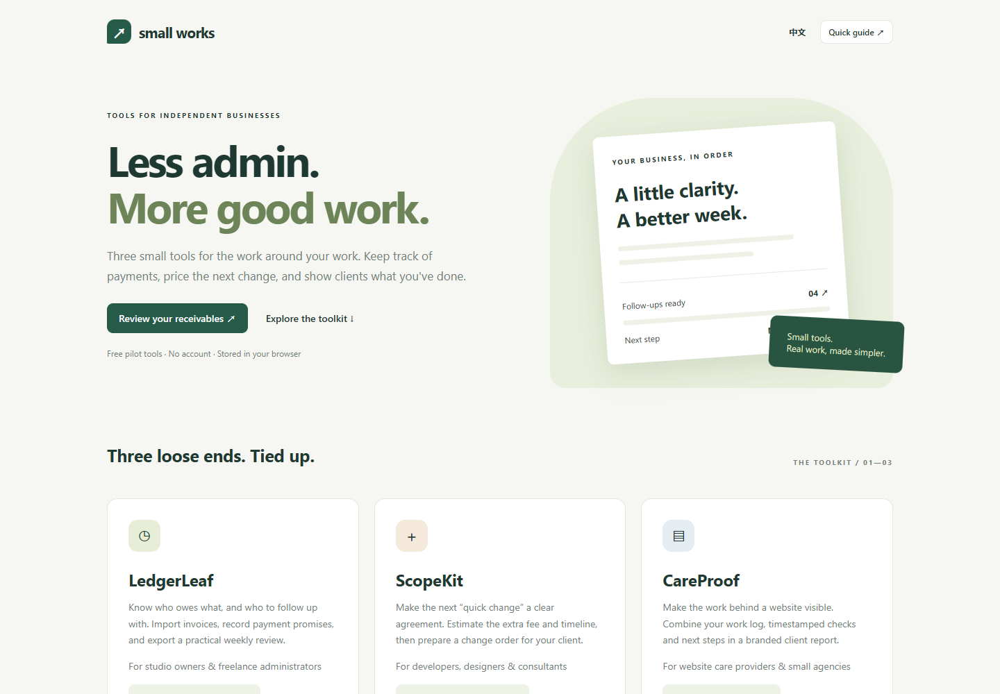

# Small Works

Three free browser tools for independent studios. No account, server database, document upload or subscription.

**[Open the live toolkit](https://zhang21901.github.io/small-works/)** · [Report an issue](https://github.com/Zhang21901/small-works/issues)

| Tool | Useful for | Output |
|---|---|---|
| LedgerLeaf | CSV invoice imports, partial payments, payment promises and aging by currency | Follow-up drafts, weekly HTML review, CSV and JSON backup |
| ScopeKit | Agreeing on additional scope, hours, fee, deposit and revised delivery | HTML change order, email draft, JSON backup |
| CareProof | Recording website maintenance work and timestamped checks | Branded monthly HTML report and JSON backup |

## Important behavior
Data stays in this browser's local storage. Export backups regularly. Clearing site data removes your local records. There is no cloud sync. Email actions prepare drafts; the tools never send automatically. Accepted quotes are manual records, not electronic signatures. CareProof does not monitor uptime. Review every output before using it with a client.

## Run locally
Serve this directory with any static HTTP server. Node users can run <code>npx http-server .</code> (installs a third-party development tool). Open index.html through HTTP, not file://.

## Feedback
Use GitHub Issues and include browser, steps and expected behavior. Use synthetic examples; never post customer invoices or confidential records. This is a public beta with no support SLA.

## Source availability
Source is published for inspection and to serve this public demonstration. Copyright 2026 Zhang21901. All rights reserved unless a file states otherwise; publication does not grant a separate redistribution license.
